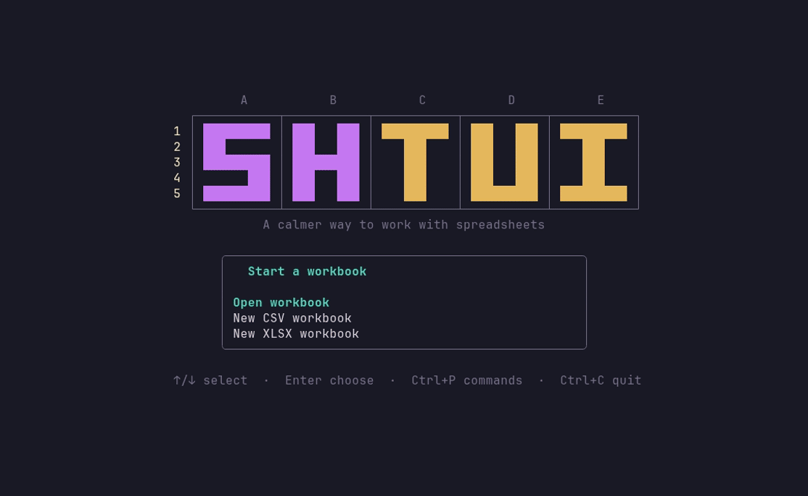
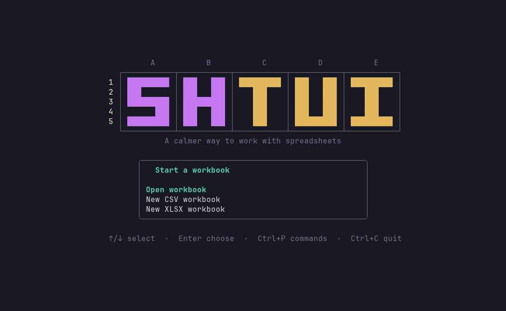
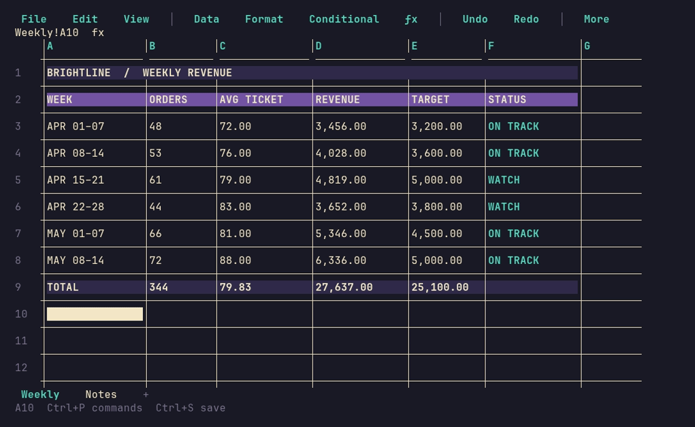
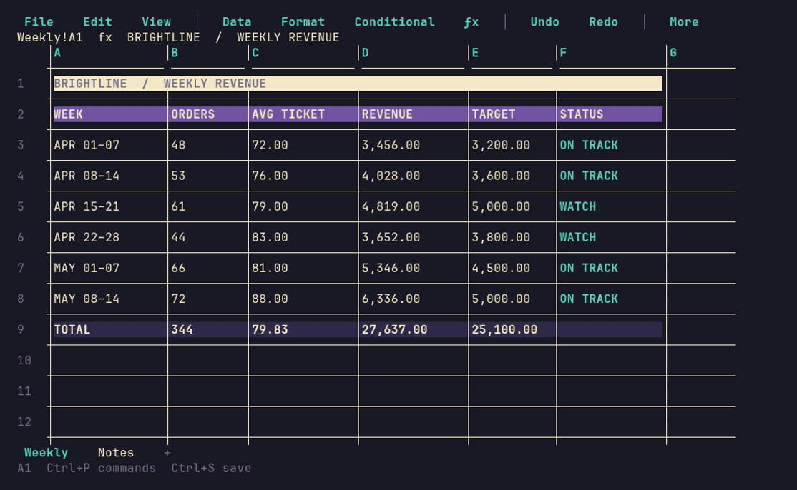
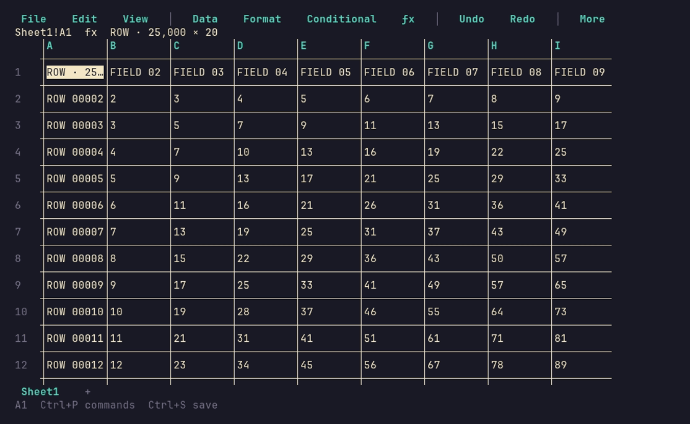

<div align="center">
  

  <p><strong>A spreadsheet for your terminal.</strong></p>
  <p>Open CSV and XLSX workbooks, edit cells and formulas, style sheets, and keep your hands on the keyboard.</p>
</div>

## See it in action

Start Shtui, open a workbook, browse its sheets, and quit safely:



**Build a sheet with formulas**



**Open a styled workbook**



**Apply conditional formatting**



**Navigate a 25,000 × 20 CSV**



## Features

Shtui brings spreadsheet editing to the terminal, with keyboard and mouse controls and a searchable command palette.

- **CSV and XLSX workbooks:** open and save files, create new workbooks, and switch between XLSX sheets. CSV is a single-sheet format and cannot store workbook-only features.
- **Cell editing and navigation:** edit cells and ranges, move through the grid with familiar spreadsheet keys, and use the mouse for selection and column resizing.
- **Formulas:** enter arithmetic, cell references, and ranges; supported functions include `SUM`, `AVERAGE`, `COUNT`, `COUNTA`, `MIN`, `MAX`, `IF`, `COUNTIF`, and `IFERROR`.
- **Formatting:** apply fills, font colors, bold, borders, merged cells, and conditional formatting.
- **Data tools:** find, sort, filter, undo, and redo.
- **Large grids:** virtualized rendering targets workbooks up to roughly 25,000 rows by 20 columns per sheet; this is a target, not a guarantee.

Formula calculation is intentionally limited, and Shtui is not a full Excel replacement. CSV cannot retain workbook-only formatting, merges, or multiple sheets. See the [usage guide](docs/usage.md) for supported behavior and format details.

## How Shtui compares

Different tools suit different spreadsheet and data workflows. Shtui focuses on editing CSV and XLSX workbooks in a terminal; it does not aim to match the breadth of desktop spreadsheet suites.

| Tool | Best fit | How it differs from Shtui |
| --- | --- | --- |
| **Shtui** | Terminal-first editing of CSV and XLSX workbooks, with spreadsheet-style navigation, formatting, and a command palette. | Formula calculation and workbook features are intentionally limited. |
| [sc-im](https://github.com/andmarti1424/sc-im) | A Vim-like terminal spreadsheet with configurable key mappings, scripting, and support for several spreadsheet and tabular formats. | Uses a Vim-style interaction model; Shtui offers a command palette and keyboard or mouse controls. |
| [VisiData](https://www.visidata.org/) | Exploring and transforming tabular data across many formats, including very large datasets. | A data-exploration multitool rather than a workbook-focused editor; Shtui emphasizes editing cells and workbook presentation. |
| [LibreOffice Calc](https://website.libreoffice.org/discover/calc/) | A full desktop spreadsheet with advanced functions, analysis tools, formatting, and XLSX/ODS support. | Better suited to broad desktop spreadsheet work; Shtui is designed for a terminal workflow. |
| [Microsoft Excel](https://www.microsoft.com/en-us/microsoft-365/excel/spreadsheets) | A full-featured desktop and online spreadsheet for formulas, charts, pivot tables, analysis, and collaboration. | Offers a much broader feature set; Shtui is a smaller terminal-first tool, not a feature-for-feature replacement. |

## Install

On Linux, from a checkout, run the installer:

```sh
bash scripts/install.sh
```

It builds `shtui` into `~/.local/bin`, creates a user-level desktop entry, and registers CSV/XLSX file associations. It requires Go and `xdg-mime`; it does not use `sudo`. Registering CSV as the default may replace your current CSV handler.

Once a version tag is released, its prebuilt archives and checksums will appear on [GitHub Releases](https://github.com/daysgobye/shtui/releases). The checkout installer and desktop integration are Linux-only.

Or build and launch directly:

```sh
go build -o shtui ./cmd/shtui
./shtui [workbook.csv|workbook.xlsx]
```

With no workbook path, choose **Open file**, **New CSV workbook**, or **New XLSX workbook** from the start screen. For shortcuts and complete file-format behavior, see the [usage guide](docs/usage.md).

## License

Shtui is licensed under the [MIT License](LICENSE).
